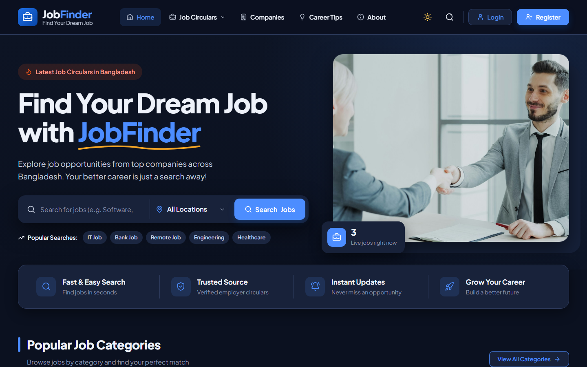
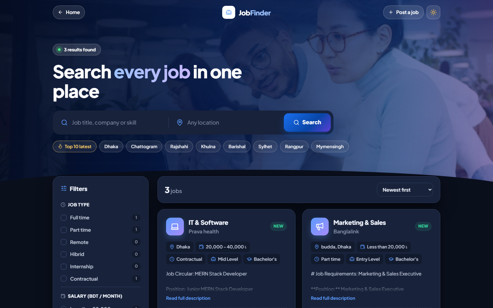
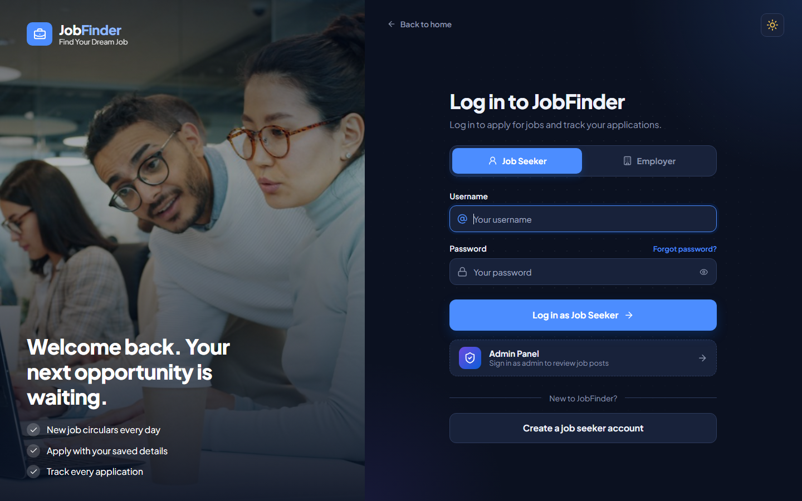
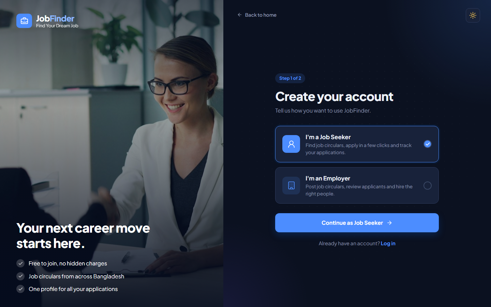
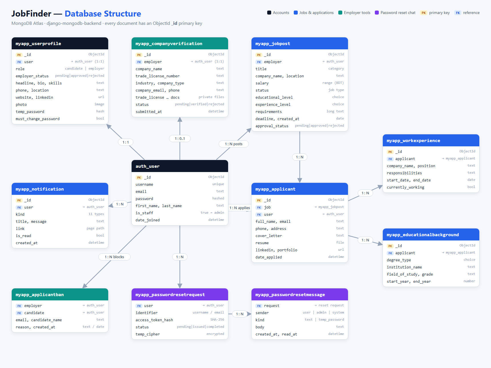

<div align="center">

# 💼 JobFinder — Job Circular Website

A job portal for Bangladesh where job seekers find and apply for jobs, and employers post job circulars and review applicants.

<a href="https://job-circular.vercel.app"></a>
&nbsp;
<a href="https://job-circular-api.onrender.com/api/health/"></a>


</div>

## 🌐 Live Links
| | URL | Hosted on | Status |
|---|---|---|---|
| 🖥️ **Frontend (Website)** | **[https://job-circular.vercel.app](https://job-circular.vercel.app)** |  | 🟢 Production |
| ⚙️ **Backend (REST API)** | **[https://job-circular-api.onrender.com](https://job-circular-api.onrender.com/api/health/)** |  | 🟢 Production |
| ❤️ **API Health Check** | **[/api/health/](https://job-circular-api.onrender.com/api/health/)** → `{"status": "OK", "database": "connected"}` |  | 🟢 Connected |

> ⏳ **Note:** The backend runs on Render's free plan and sleeps when idle, so the **first load can take 30–50 seconds**. After that it's fast.



## 📖 About the Project
**JobFinder** is a full-stack job circular platform built for the Bangladeshi job market. It connects three types of users (**Job Seekers**, **Employers** and an **Admin**) on one site, and each gets their own dashboard and permissions.

The backend is a **Django REST API** with **MongoDB Atlas** as the database. The frontend is a separate **React (Vite)** single-page app. Every job post and employer account is reviewed by the admin before it goes public, so job seekers only see verified circulars.

### 👤 For Job Seekers
- Browse the latest job circulars, or search by **keyword, location and category**
- Filter by **job type** (full time, part time, remote, internship, contractual), **salary range**, **experience** and **education level**
- Build a profile with photo, work experience and educational background
- **Apply with a resume** in a few clicks and track every application
- Get **notifications** about important updates

### 🏢 For Employers
- Sign up as an employer and get approved by the admin
- **Verify the company** by uploading documents (trade license, TIN, etc.), which are stored privately
- **Post job circulars** with salary, experience level, education and job type
- See all **applicants** for each job, download resumes, and **browse candidates**
- Block unwanted applicants from applying again

### 🛡️ For Admin
- A dedicated **Admin Panel** to approve or reject **job posts**, **employer accounts** and **company verifications**
- Handle **forgot-password requests** through a built-in chat, and issue a temporary password to the user

### 🎨 Other Highlights
- 🌗 **Light / dark mode** that is remembered across visits
- 📱 **Fully responsive**, works on mobile, tablet and desktop
- 🔐 **Per-tab login sessions**: different accounts can stay logged in on different browser tabs
- 🖼️ Clean, modern UI with real photos and Lucide icons

## 📸 Screenshots
| Browse Jobs | Login |
|---|---|
|  |  |
| **Sign Up** | |
|  | |

## 🔄 How It Works

### 1. Job Seeker journey
1. **Sign up** as a Job Seeker → a welcome notification is created.
2. **Complete the profile** (headline, skills, bio, photo, LinkedIn, website).
3. **Search jobs** from the home page or the *All Jobs* page, using filters to narrow down.
4. **Apply** to a job: fill in contact details and a cover letter, upload a resume, and add work experience and education.
5. The employer gets a **"New applicant"** notification, and the job seeker gets **"Application sent"**.

### 2. Employer journey
1. **Sign up** as an Employer → the account starts as **Pending**.
2. The admin **approves** the employer account → the employer can now post jobs.
3. (Recommended) Submit **company verification** with the trade license and other documents → the admin marks the company **Verified** or **Rejected**.
4. **Post a job** → it stays **Pending review** until the admin approves it, and only then appears publicly.
5. Open **My Applicants** to see everyone who applied, read their details and download resumes.
6. If needed, **block** a job seeker so they can't apply to that employer's jobs again.

### 3. Admin journey
1. Log in through the separate **Admin login** (staff accounts only).
2. Review the queues in the **Admin Panel**: pending **job posts**, **employer accounts** and **company verifications**, each with *Approve* / *Reject (with reason)*.
3. Answer **forgot-password chats**. When satisfied it's the real user, send a **one-time temporary password**. The user logs in with it and must set a new password right away.

> Approving or rejecting a **job post** or a **company verification** automatically sends a **notification** to the employer.

## 🏗️ Architecture
```
 ┌──────────────────────┐   /api/*  (proxied)   ┌────────────────────────┐        ┌──────────────────┐
 │  React + Vite (SPA)  │ ────────────────────► │  Django 5.2 REST API   │ ─────► │  MongoDB Atlas   │
 │  Vercel              │ ◄──────────────────── │  Render (gunicorn)     │ ◄───── │  (jobportal DB)  │
 └──────────────────────┘        JSON           └────────────────────────┘        └──────────────────┘
                                                  │ media/          → resumes, profile photos (public)
                                                  │ private_media/  → company documents (API only)
```
- The frontend calls everything under **`/api/...`**. In development, Vite proxies it to Django. In production, Vercel rewrites it to Render (see [`frontend/vercel.json`](frontend/vercel.json)), so the browser always talks to one domain.
- **Login sessions are per browser tab**: the session key is sent in an `X-Session-Key` header and kept in `sessionStorage`, so two tabs can be logged in as different users.
- The frontend follows an **MVC-style** structure: `models/` (API calls), `controllers/` (React hooks with the logic), `views/` (pages, components and CSS).

## 🗄️ Database Structure
The project uses **MongoDB Atlas** through **`django-mongodb-backend`**, so Django models are stored as MongoDB **collections**, and every document's primary key is a MongoDB **`ObjectId`**. Collections are named `myapp_<model>` (for example `myapp_jobpost`).

### Schema diagram


> **How to read it:** each box is a MongoDB collection. **PK** = primary key (`_id`, an ObjectId) and **FK** = a reference to another collection. Arrows show relationships: **1 : 1** = one to one, **1 : N** = one to many. `auth_user` is the center: every account (job seeker, employer or admin) is one document there, and almost everything else points back to it.

### Collections

#### 👤 `auth_user` (Django built-in)
The login account for **everyone** (job seekers, employers and admins).
| Field | Description |
|---|---|
| `username`, `email`, `password` | Login details (the password is stored **hashed**) |
| `first_name`, `last_name` | User's name |
| `is_staff` | `true` = **Admin** |
| `date_joined`, `last_login` | Timestamps |

#### 🪪 `myapp_userprofile`
Extra profile details and the **role** of each user (one-to-one with `auth_user`).
| Field | Description |
|---|---|
| `user` | → `auth_user` |
| `role` | `candidate` (Job Seeker) or `employer` |
| `employer_status` | `pending` / `approved` / `rejected`. Only approved employers can post jobs |
| `employer_rejection_reason`, `employer_reviewed_at` | Admin's review result |
| `headline`, `bio`, `skills`, `phone`, `location` | Public profile info (`skills` is comma-separated) |
| `website`, `linkedin`, `photo` | Links and profile photo (`media/profile_photos/`) |
| `temp_password`, `temp_password_expires_at` | **Hash** of a one-time password issued by the admin |
| `must_change_password` | Forces a new password after a temporary-password login |
| `updated_at` | Last profile update |

#### 💼 `myapp_jobpost`
A job circular posted by an employer.
| Field | Description |
|---|---|
| `employer` | → `auth_user` (the employer who posted it) |
| `company_name`, `location` | Company and job location |
| `title` | Category: Technology, Networking, Engineering, Marketing, Content Writing, Customer Support, Finance, Healthcare, Design, Education |
| `salary` | `<20000`, `20000-40000`, `40000-60000`, `60000-80000`, `80000-100000`, `>100000` (BDT/month) |
| `status` | Job type: `full_time`, `part_time`, `remote`, `hibrid`, `internship`, `contractual` |
| `educational_level` | `high_school`, `bachelors`, `masters`, `phd` |
| `experience_level` | `entry_level` (0–2 yrs), `mid_level` (3–5 yrs), `senior_level` (5+ yrs) |
| `requirements` | Full job description (up to 10,000 characters) |
| `deadline`, `created_at` | Application deadline and post date |
| `approval_status` | `pending` / `approved` / `rejected`. Only **approved** jobs are public |
| `rejection_reason`, `reviewed_at` | Admin's review result |

#### 📄 `myapp_applicant`
One job application.
| Field | Description |
|---|---|
| `job` | → `myapp_jobpost` |
| `user` | → `auth_user` (the job seeker) |
| `full_name`, `email`, `phone`, `address` | Contact details |
| `cover_letter` | Optional cover letter |
| `resume` | Uploaded file (`media/resumes/`) |
| `linkedin_profile`, `portfolio_website` | Optional links |
| `date_applied` | When the application was sent |

#### 🧑‍💼 `myapp_workexperience`
Work history attached to an application (one applicant → many).
| Field | Description |
|---|---|
| `applicant` | → `myapp_applicant` |
| `company_name`, `position` | Where and what role |
| `responsibilities`, `description` | Details |
| `start_date`, `end_date`, `currently_working` | Period (`end_date` is empty while still working there) |

#### 🎓 `myapp_educationalbackground`
Education attached to an application (one applicant → many).
| Field | Description |
|---|---|
| `applicant` | → `myapp_applicant` |
| `degree_type` | High School, Associate, Bachelor's, Master's, Doctorate, Other |
| `institution_name`, `field_of_study`, `grade` | Details |
| `start_year`, `end_year` | Period |

#### 🏢 `myapp_companyverification`
Company details and documents an employer submits to prove the company is real (one per employer).
| Field | Description |
|---|---|
| `employer` | → `auth_user` |
| `company_name`, `trade_license_number`, `company_type`, `industry`, `year_established` | Company info |
| `company_address`, `company_email`, `company_phone`, `company_website` | Contact info |
| `contact_person`, `contact_designation`, `ceo_name` | People |
| `trade_license` *(required)*, `tin_certificate`, `incorporation_certificate`, `owner_id_document`, `other_document` | PDF/JPG/PNG files stored in **`private_media/`**, downloadable only by the owner and admins |
| `status` | `pending` / `verified` / `rejected` |
| `rejection_reason`, `submitted_at`, `reviewed_at` | Review info |

#### 🔔 `myapp_notification`
In-app notifications shown under the bell icon.
| Field | Description |
|---|---|
| `user` | → `auth_user` (the receiver) |
| `kind` | `welcome`, `job_submitted`, `job_approved`, `job_rejected`, `company_submitted`, `company_verified`, `company_rejected`, `application_sent`, `new_applicant`, `profile_updated`, `password_changed` |
| `title`, `message` | Text shown to the user |
| `link` | Page to open when clicked (e.g. `/profile`) |
| `is_read`, `created_at` | Read state and time |

#### 🔑 `myapp_passwordresetrequest`
A **forgot-password** conversation between a logged-out user and the admins.
| Field | Description |
|---|---|
| `user` | → `auth_user` (empty if no account matched) |
| `identifier` | Username or email the user typed |
| `access_token_hash` | SHA-256 of the secret token kept in the user's browser (the token itself is never stored) |
| `status` | `pending` → `issued` (temp password sent) → `completed`, or `rejected` |
| `reviewed_by`, `reviewed_at`, `completed_at`, `rejection_reason` | Review info |
| `temp_cipher`, `temp_nonce`, `temp_expires_at`, `temp_used_at` | The temporary password, **encrypted**, wiped after use or expiry |

#### 💬 `myapp_passwordresetmessage`
One chat message inside a password-reset request.
| Field | Description |
|---|---|
| `request` | → `myapp_passwordresetrequest` |
| `sender` | `user` / `admin` / `system` |
| `author` | → `auth_user` (the admin who replied) |
| `kind` | `text` or `temp_password` |
| `body`, `created_at`, `read_at` | Message, time sent and time seen |

#### 🚫 `myapp_applicantban`
A job seeker blocked by an employer.
| Field | Description |
|---|---|
| `employer` | → `auth_user` (who blocked) |
| `candidate` | → `auth_user` (who is blocked) |
| `email`, `candidate_name` | Also matched by email, for older applications without an account |
| `reason`, `created_at` | Why and when |

#### Other collections
- **`django_session`**: server-side login sessions.
- **`auth_group`, `auth_permission`, `django_content_type`, `django_admin_log`**: Django built-ins for the `/admin/` site.
- **Legacy:** `myapp_employee`, `myapp_candidate` and `myapp_jobapplicationform` come from an older version of the project and are **not used** by the current React app. Accounts now live in `auth_user` + `myapp_userprofile`.

## 🔌 API Overview
All endpoints are under `/api/` and return JSON.
| Area | Endpoints |
|---|---|
| **Auth** | `auth/signup/`, `auth/login/`, `auth/logout/`, `auth/me/`, `auth/admin-login/`, `auth/profile/`, `auth/password-change/`, `auth/password-set/` |
| **Forgot password chat** | `auth/password-reset/`, `auth/password-reset/thread/`, `auth/password-reset/thread/status/` |
| **Jobs** | `jobs/` (list + create), `jobs/<id>/`, `jobs/<id>/apply/`, `jobs/<id>/applicants/` |
| **Employer** | `employer/applicants/`, `employer/bans/`, `applicants/<id>/resume/`, `candidates/`, `candidates/<id>/` |
| **Company** | `company-verification/`, `company-verification/<user_id>/documents/<field>/` |
| **Notifications** | `notifications/`, `notifications/read/` |
| **Admin** | `admin/jobs/`, `admin/employers/`, `admin/companies/` (each with `<id>/approve/` or `verify/`, and `reject/`), `admin/password-requests/` (+ `messages/`, `issue/`, `reject/`) |
| **Utility** | `health/`, `csrf/` |

## 📁 Project Structure
```
Django_Job_Circular_Website-main/
├── backend/                  # Django project
│   ├── myproject/            # settings, urls, wsgi
│   ├── myapp/                # models, API views (api.py), API urls, middleware
│   ├── mongo_migrations/     # migrations for Django's built-in apps (ObjectId keys)
│   └── manage.py
├── frontend/                 # React + Vite app
│   ├── src/
│   │   ├── models/           # API calls (httpClient, JobModel, AuthModel, ...)
│   │   ├── controllers/      # React hooks with page logic
│   │   ├── views/            # pages, components, styles, images
│   │   └── config/           # route paths
│   └── vercel.json           # Vercel rewrites → Render backend
├── docs/screenshots/         # README images
├── render.yaml               # Render deployment config
└── requirements.txt          # Python dependencies
```

## 🛠️ Tech Stack
| Layer | Technology |
|---|---|
| **Frontend** | React 19, Vite 7, React Router 7, Lucide icons, plain CSS (light/dark themes) |
| **Backend** | Python, Django 5.2, gunicorn, WhiteNoise |
| **Database** | MongoDB Atlas via `django-mongodb-backend` + PyMongo |
| **Hosting** | Vercel (frontend), Render (backend) |

## ⚙️ Run Locally
```bash
# Backend
cd backend
python -m venv venv && venv/Scripts/activate   # Linux/macOS: source venv/bin/activate
pip install -r ../requirements.txt
# create backend/.env with MONGODB_URI=... and MONGODB_DB=jobportal
python manage.py migrate
python manage.py runserver

# Frontend (new terminal)
cd frontend
npm install
npm run dev     # http://localhost:5173
```

## 🚀 Deployment
The project is live in production, and both parts **deploy automatically on every push to `main`**.

```
 git push origin main
        │
        ├──► Vercel  → builds frontend/  (npm install → vite build)  → https://job-circular.vercel.app
        └──► Render  → builds backend/   (pip install → collectstatic → migrate → gunicorn)
                                                                     → https://job-circular-api.onrender.com
```

### 🖥️ Frontend: Vercel
| Setting | Value |
|---|---|
| Root Directory | `frontend` |
| Framework | Vite |
| Build Command | `vite build` (output: `dist/`) |
| Config file | [`frontend/vercel.json`](frontend/vercel.json) |

`vercel.json` forwards `/api/*`, `/admin/*`, `/static/*`, `/media/*` and `/reset/*` to the Render backend, and sends every other path to `index.html` so React Router can handle it. The browser only ever talks to **one domain**, so login and CSRF work without any CORS setup.

### ⚙️ Backend: Render
| Setting | Value |
|---|---|
| Root Directory | `backend` |
| Runtime | Python 3.12 (free plan, Singapore region) |
| Build Command | `pip install -r ../requirements.txt && python manage.py collectstatic --noinput` |
| Start Command | `python manage.py migrate --noinput && gunicorn myproject.wsgi:application` |
| Config file | [`render.yaml`](render.yaml) |

**Environment variables** (set in the Render dashboard, never committed):
| Variable | Purpose |
|---|---|
| `MONGODB_URI` | MongoDB Atlas connection string |
| `MONGODB_DB` | Database name (`jobportal`) |
| `SECRET_KEY` | Django secret key (random) |
| `DEBUG` | `False` in production |
| `CSRF_TRUSTED_ORIGINS` | `https://job-circular.vercel.app` |
| `FRONTEND_URL` | `https://job-circular.vercel.app` |

### 🍃 Database: MongoDB Atlas
Network Access allows `0.0.0.0/0` so Render's servers can connect.

> ⚠️ **Free-plan limits:** the Render backend sleeps after ~15 minutes idle (the first request then takes 30–50 seconds), and uploaded files (resumes, photos, company documents) are stored on Render's temporary disk, so they are **lost on every redeploy**.

## 👨‍💻 Author
**Khandoker Md. Ragib Ahsan** — [GitHub](https://github.com/ragibKhandoker)
